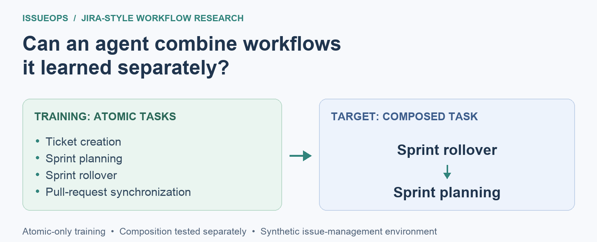
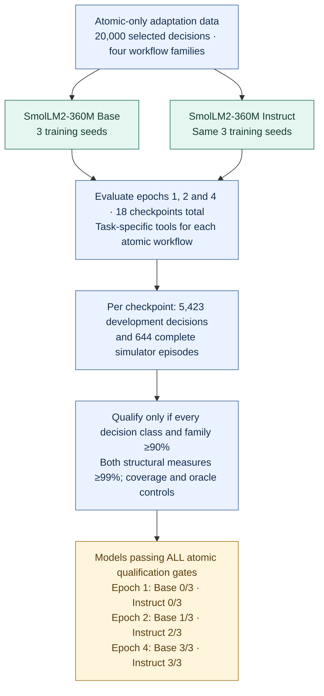
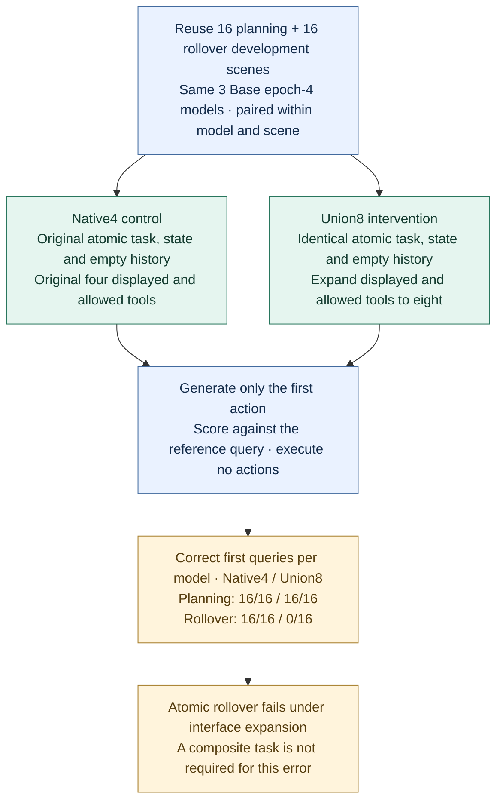
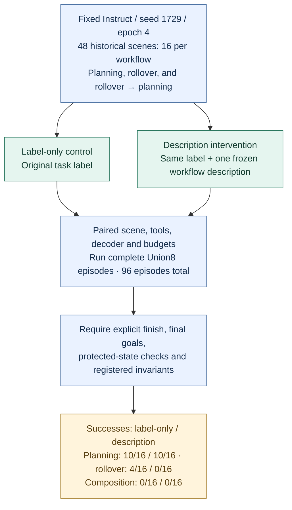

# IssueOps: investigating workflow composition and interface transfer

An independent research project on small language-model agents in a deterministic issue-management simulator. I asked whether agents trained on individual workflows can reliably combine them. The most useful outcome was a change in interpretation: passing atomic workflow tests did **not** establish competence when the available tool interface expanded.

This repository is a research portfolio, with completed experiments, negative findings, reproducible result analysis and explicit stopping boundaries. It is not a published-paper claim.

## What workflows does the agent perform?

IssueOps is a **Jira-style simulator**, not a connection to a live Jira service. An **atomic workflow** is one complete business task; the composition test asks the agent to carry out two of them in sequence.

| Workflow | What the agent must do |
| --- | --- |
| Ticket creation | Turn a business request into a ticket, copy required fields and avoid duplicates. |
| Sprint planning | Prioritize backlog work, match tickets to developers with the required skills and remaining capacity, then assign and schedule feasible work. |
| Sprint rollover | Open the next sprint, carry forward unfinished unblocked work, and defer blocked work according to the simulator's rules. |
| Pull-request synchronization | Keep a linked ticket consistent with pull-request review, approval and merge status. |

**The tested composition is sprint rollover → sprint planning.** The agent must first handle unfinished work from the previous sprint, then use the remaining developer capacity to assign and schedule new backlog work. For example, carried-over work may leave too little capacity for a high-priority ticket; the agent must still consider later feasible work. Simply running two memorized action sequences is insufficient if their shared state is wrong.

Only this rollover-then-planning combination is tested here; ticket creation and pull-request synchronization are component qualification tasks, not additional tested compositions.

## Research at a glance

### Stage 1 — Can the agent reliably execute the component workflows?

**Question:** before asking an agent to combine workflows, can it execute each component reliably on its own?

The initial study planned to compare three forms of procedural support: no guidance, written skill guidance, and an executable skill controller. It stopped before the composition comparison because neither permitted model candidate could reliably complete every component workflow. **A separate component-learning experiment** then tested whether a 360M-parameter model could acquire those workflows under a different training setup, comparing its pretrained **Base** version with its instruction-tuned **Instruct** version:



**How to read the counts.** Each initialization was trained three times with different random seeds. “Base 1/3” means one of those three trained models passed **every** atomic qualification gate at that epoch; it is not a 1/3 task-success rate. An epoch is one pass through the training data. The evaluation schedule was fixed in advance at epochs 1, 2 and 4 to compare increasing training exposure within the same four-epoch run. Epoch 3 was trained but not exported or evaluated as a checkpoint; epoch 4 is therefore the earliest **measured** point at which both initializations qualified across all three seeds, not necessarily the first epoch at which they could have qualified.

**Finding.** At epoch 4, all three Base models and all three Instruct models qualified under task-specific interfaces. Complete-workflow success was 100% in every family for five of the six models; the remaining Base model succeeded on 184/186 planning episodes and all episodes in the other families. This establishes atomic development qualification, not a Base/Instruct ranking.

**What about the composed task?** It was not evaluated in this component-learning experiment. The predeclared selection rule chose Base epoch 4 for a separate rollover → planning pilot. That pilot, reported in Stage 2, achieved **0/16 verified successes (0%) for each of the three models**, on the same 16 scenes.

**Why another stage?** Passing the component tests made it possible to ask whether those skills transfer to rollover → planning. The subsequent 0/16 result exposed a gap between component qualification and composition performance. Stage 2 reports that pilot and the controls used to investigate whether the gap reflects composition itself or changes in task labels, state representation and available tools.

### Stage 2 — Is the failure about composition, or about the changed interface?

**Question:** when qualified agents fail rollover → planning, can expanding the available tools already trigger an error on an unchanged atomic task?

**Initial test and diagnostic path.** The composition pilot ran complete rollover → planning episodes on 16 shared scenes for each of the three selected Base models, with a 32-step limit. Every model scored **0/16 successes**, despite **510/510 structurally valid actions** in total. The investigation then separated possible explanations:

| Check | What we changed or inspected | What we observed — and what it means |
| --- | --- | --- |
| Change the task name | Kept the same tickets and tools; renamed the task as composition, rollover, or planning. | Every model still began by asking for backlog tickets. **Changing the name alone did not make it start with rollover.** This does not prove that task names never matter. |
| Remove extra ticket details | Removed priority and work-estimate fields, while keeping the same eight tools. | Every model still asked for backlog tickets. **Removing these details did not correct the first step.** |
| Restrict the available tools | Kept the task fixed but offered only the four rollover tools. | Every model switched to asking for unfinished work. **But the backlog query was now unavailable**, so this did not show that the model could choose correctly when both queries were offered. |
| Inspect earlier training and evaluation records | Checked the allowed-action sets reconstructed for 20,000 training and 5,423 development decisions. | No reconstructed set offered both the backlog query and the unfinished-work query together. **The earlier atomic tests had not checked this choice.** This was an analysis of saved records, not a new training run; it does not mean training loss excluded other tools. |

The distinction matters: rollover should start by finding unfinished work, whereas planning starts by finding backlog work. These checks suggested testing whether the agent could make that choice when both queries were available—even without combining the workflows.

These checks motivated a **paired tool-interface experiment on unchanged component tasks**. Native4 means the four tools for one workflow; Union8 means the combined planning and rollover tool set.



**Finding.** On these fixed atomic inputs, interface expansion alone was sufficient to change every correct rollover first query to the rival backlog query. The composition pilot therefore cannot isolate composition ability. Displayed tools and decoder vocabulary changed together; The interface experiment does not separate their effects, explain every later workflow failure, or demonstrate a repair.

**Why another stage?** A first-query diagnostic cannot establish whether an agent can finish an atomic workflow under Union8. A stronger composition test would need complete-flow atomic checks and suitable follow-up data, rather than assuming native-interface qualification transfers.

### Stage 3 — Do complete-flow checks and the data support a stronger test?

**Questions:** does one fixed task description improve complete workflows under Union8? Separately, can the proposed joint-interface follow-up dataset meet its independence and coverage rules?

These were two related branches. The description diagnostic added model predictions on historical scenes; Follow-up data preparation audited source feasibility without evaluating a learner.



**Complete-flow finding.** The fixed descriptions did not improve success in these scenes; neither condition passed the complete atomic sample check. This exploratory study retained 42 completed episodes and recovered 54 missing ones after interruption, with possible frontier reexposure. It is not an independent final test, and composition failure still does not isolate composition ability.

**Parallel data-feasibility finding.** Follow-up data preparation compared candidate trajectories against historical exposure and cross-partition equality, then checked eligible representatives against frozen quotas. Reanalysis reproduced all **18,889** saved exclusion decisions. Every rollover stratum had zero eligible representatives; planning singletons had **13 train / 1 development**, below **128 / 32** required. The data gate failed before any follow-up learner evaluation.

**What would justify a next stage?** A prospective data-design amendment and complete atomic qualification under the joint interface would be needed before interpreting a new composition test. The grouped-holdout amendment remains a draft. Data preparation preceded the description study; saved exclusion diagnosis followed it. These branches are not a new successful repair experiment.

| Evidence | Design and denominator | Main result | Interpretation boundary |
| --- | --- | --- | --- |
| Component-learning experiment | 18 checkpoints; each on 5,423 development decisions and 644 episodes | Base and Instruct each qualify 3/3 seeds at epoch 4 | Development qualification; no superiority or scale claim |
| Composition pilot | 16 shared scenes × 3 Base seeds | Each 0/16 verified successes; 510/510 structurally valid actions | Task, state and interface shifts co-vary |
| Task-label / state-and-tool controls | 144 / 192 first-action predictions, paired scenes | Labels and tested field removal leave actions unchanged | No workflow execution; unchanged argmax is not unchanged logits |
| Coverage reanalysis | 20,000 train + 5,423 development records | No reconstructed grammar offers both competing queries | Training loss itself uses the full token vocabulary |
| Paired tool-interface experiment | 16 atomic scenes per family × 3 seeds × 2 interfaces | Rollover 16/16 → 0/16; planning 16/16 → 16/16, per seed | First action only; displayed and allowed tools change jointly |
| Fixed Instruct descriptions | 48 historical scenes × 2 conditions; one checkpoint | Planning 10/16 vs 10/16; rollover 4/16 vs 0/16; composition 0/16 vs 0/16 | Exploratory, interrupted/recovered; not an independent final test |
| Follow-up data-feasibility diagnosis | 18,889 candidates | All exclusions reproduced; data gate still fails | No learner evaluation or repair result |

Counts across model seeds reuse scenes. Predictions and actions are not independent scene samples. These are bounded descriptive results and paired interventions, not population effect estimates. Zero observed success does not establish zero underlying capability.

## The problem and why it matters

A workflow agent can produce well-formed tool calls yet leave its objective unfinished. It may also pass tests with task-specific tools while failing when tools from several workflows are available together. A composition benchmark must separate these failures before attributing them to reasoning or procedural knowledge.

The shared simulator state makes the composition meaningful: rollover changes ticket status, sprint membership and developer workload, which determine what planning can do next. Evaluation checks the resulting goals and protected entities, rather than accepting a plausible-looking action sequence.

## What I built and investigated

- A deterministic simulator, atomic/composed task generators, tool runtime and state verifier.
- Qualification gates combining semantic decision accuracy, complete workflow success and structural validity.
- Atomic-only small-model adaptation followed by a separate composition pilot.
- Paired label, state and interface diagnostics, plus offline coverage and trajectory analysis.
- A source-independence/coverage gate that stopped an infeasible follow-up before learner evaluation.

The strongest experimental conclusion is local: on the interface experiment’s fixed atomic rollover inputs, expanding the displayed/allowed tool interface suffices to change every correct first query to the rival query. It does not identify which component of that expansion matters, explain every composition-pilot error, or demonstrate a repair.

## What I learned about research

**Make qualification match the claim.** The component-learning gates made a composition test more credible, but the paired interface experiment showed that qualification was tied to the interface used during evaluation. Passing with four task-specific tools did not establish correct routing when eight tools were available. I learned to ask whether the prerequisites cover the conditions of the proposed test, rather than treating a qualified checkpoint as universally competent.

**Choose a control that can challenge the explanation.** The composition pilot’s zero successes could invite a broad claim about composition failure. Yet composition, task labels, state layout and tools changed together. Label and state/tool controls tested specific alternatives; the paired interface experiment then preserved the atomic task and changed the interface. That control materially narrowed the conclusion: the observed error did not require a composite task. It still did not explain every composition-pilot failure or show how to repair them.

**Measure completion, not just plausible actions.** The composition pilot produced 510 structurally valid actions without a successful episode. In the description study, rollover with descriptions made 100 read calls, no writes, and finished prematurely in all 16 scenes. Neither clean syntax nor the absence of execution errors meant the objective was achieved. This made goals, protected-state checks and explicit completion central to how I interpreted agent reliability.

**Let uncertainty and provenance limit the story.** Repeated predictions across three models were not independent scenes; reused development inputs were not a new final test. Unchanged first actions did not prove that labels were ignored, and one fixed description's lower rollover success did not show that descriptions are generally harmful. Recording these boundaries changed which explanations I could defend.

**Treat a failed data gate as a research result about feasibility.** The follow-up dataset’s exclusions were computationally reproducible, but the surviving data could not meet the registered quotas. Reproducing the audit did not make the dataset adequate or validate every identity definition. The defensible endpoint was to preserve the failure and require a prospective amendment, not silently relax rules until training became possible.

Together, these decisions shifted the project from asking only whether a model succeeds to asking **what the evaluation permits us to infer about the failure**. They shaped my interest in reliable agents and evaluation methods that distinguish task competence, interface transfer and complete-workflow behavior.

[Detailed reflections](docs/reflection.md) · [Methods](docs/methods.md) · [Research process](docs/research-process.md) · [Results and limitations](docs/results-and-limitations.md) · [Evidence audit](docs/evidence-audit.md)

## Run the free, offline checks

Python 3.11+; no packages, credentials, model downloads or network calls required:

```bash
python3 analysis/reproduce.py
PYTHONPATH=src python3 -m unittest discover -s tests -v
```

The first command reaggregates saved interface-experiment predictions, checks reported gates/counts and verifies the release inventory. It does not rerun training or model inference. See [reproduction scope](docs/reproduction.md), [sources](docs/sources.md), and [upload instructions](UPLOAD.md).
